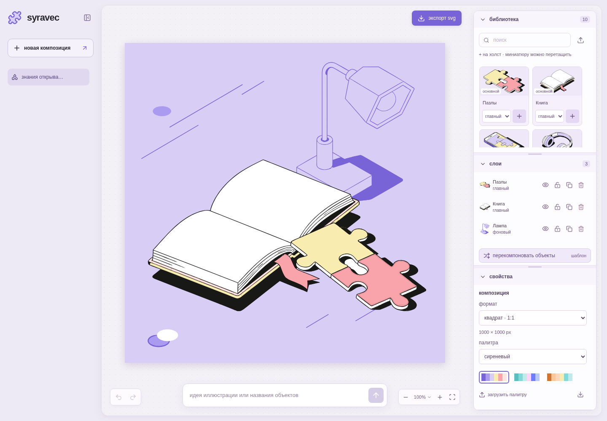
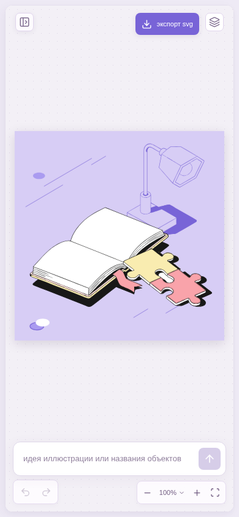
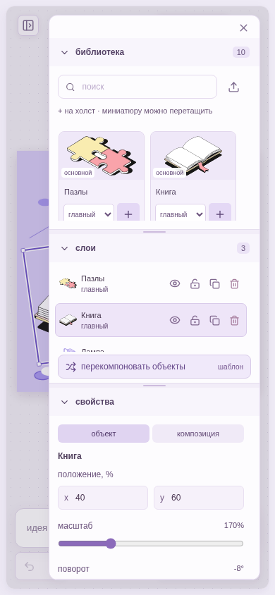

# SyraVec

An SVG composition editor with AI-assisted layouts. Built with React, TypeScript, Go, and Docker Compose.

Describe a visual idea or arrange objects from the supplied illustration library. The model plans a composition; the editor keeps the original SVG geometry and exports editable vectors.

[Open SyraVec](https://syravec.fanat-sira.art/)



*Canvas, object library, layers, and composition properties. The included examples can be explored without an API key.*

## Features

- **Compose from an idea:** describe a metaphor, headline, or scene; AI selects and arranges library objects.
- **Compose from objects:** add objects to the canvas and use **«перекомпоновать объекты»** in Layers. AI rearranges exactly that set.
- **Edit vectors:** move, rotate, duplicate with Alt-drag, reorder, hide, and lock layers; undo or redo completed actions.
- **Adjust the composition:** square, landscape, and portrait formats; two original illustration sizes, three palettes, and custom palette upload.
- **Keep projects:** browser autosave, project names, and restoration after reload.
- **Export SVG:** standalone, editable vectors with separate object groups and unique internal IDs.

<p>
  
  
</p>

## Quick start

Requires Docker Engine with the Compose plugin. Go, Node.js, and SVG preparation tools run inside Docker.

```bash
git clone https://github.com/fanat-sira/syravec.git
cd syravec
mkdir -p originals
cp .env.example .env
```

Place both supplied source archives in `originals/`, without extracting them:

| Original | Local filename |
| --- | --- |
| `Тестовое _ иллюстрации(2).zip` — large | `assets.zip` |
| `Тестовое _ иллюстрации(3).zip` — small | `assets-small.zip` |

The original filenames are also accepted. The private illustrations are distributed separately and are not included in Git or Docker images. Docker prepares both libraries automatically; a missing, ambiguous, or invalid source stops preparation with instructions. Small vectors come from their own original archive, never from scaling large vectors.

For AI generation, set your OpenRouter key in `.env`:

```dotenv
OPENROUTER_API_KEY=your_key
AI_MODEL=openai/gpt-6-luna
AI_RESPONSE_FORMAT=json_schema
```

Use a model available to your OpenRouter account. Without a key, the editor and local template layouts remain available; the layer action identifies its source as **«шаблон»**.

```bash
sudo docker compose up --build -d
```

Open **http://127.0.0.1:3000**. The `assets` container finishing with `Exited (0)` is expected: its prepared SVGs are shared with the API and web containers.

```bash
sudo docker compose logs --tail=100 assets api web
sudo docker compose down
```

## Using the editor

1. Enter an idea in Composer, or open an example to explore the editor.
2. Add library objects with `+` or drag their thumbnails onto the canvas.
3. To rearrange the current objects, use **«перекомпоновать объекты»** at the bottom of Layers. Repeat for another layout; one Undo restores the previous scene.
4. Change the illustration size, format, or palette in Properties, then use **«экспорт svg»** above the canvas.

The layer action rearranges the current canvas, including a single object, repeated copies, uploaded SVGs, and locked layers. Copies keep separate IDs. Explicit rearrangement can move locked layers; their manual lock flags remain set. A recognizable list of catalog names in Composer uses the local template, preserving repetitions and quantities such as `2 монеты, 3 ручки и лампа`. Case, punctuation, supported word forms and unambiguous minor typos are normalized. Descriptions and lists containing unknown names go intact to the main model.

Projects and uploaded SVGs stay in the current browser's IndexedDB. Clearing site data removes them. SVG uploads support static vector content without scripts, raster images, or external resources; custom palette uploads use the example JSON available in Properties.

| Action | Shortcut |
| --- | --- |
| Pan the view | Space + drag, or middle mouse button |
| Zoom the view | Ctrl + mouse wheel |
| Duplicate an object | Alt + drag |
| Undo / redo | Ctrl / ⌘ + Z / Ctrl / ⌘ + Shift + Z |
| Send / new line | Enter / Shift + Enter |

Objects retain their native SVG dimensions with one shared factor of 1; individual resizing is unavailable. **«размер иллюстраций»** switches the whole composition between the two original libraries. Positions, rotations, and layer order stay intact; intentional cropping is allowed. Compositions containing uploaded SVGs cannot switch size because those files have no alternative source. Older projects are migrated to native dimensions, which can change their appearance.

View zoom and panning do not change the exported composition. Failed or cancelled generation keeps the current scene.

## Configuration

See [`.env.example`](.env.example) for all settings. The API key stays on the backend.

| Variable | Default | Purpose |
| --- | --- | --- |
| `AI_MODEL` | `openai/gpt-6-luna` | Main composition model |
| `AI_BASE_URL` | `https://openrouter.ai/api/v1` | OpenAI-compatible endpoint |
| `AI_RESPONSE_FORMAT` | `json_schema` | `json_schema`, `json_object`, or `text` |
| `AI_IP_HOURLY_LIMIT` | `5` | Main-model calls per IP over a sliding hour |
| `AI_IP_DAILY_LIMIT` | `20` | Main-model calls per IP over sliding 24 hours |
| `AI_SERVICE_DAILY_LIMIT` | `150` | Main-model calls across the service over sliding 24 hours |
| `WEB_BIND` | `127.0.0.1` | Published web interface |
| `WEB_PORT` | `3000` | Published web port |

The main model allows two concurrent generations, each with a 45-second timeout. Limits count dispatched model calls, including a separate repair call when needed. A quota response returns HTTP 429 with `Retry-After` and the remaining wait. Template layouts, editing, autosave, and export do not consume model quotas. Counters persist in a Docker volume.

After changing `.env`, run `sudo docker compose up -d` to recreate affected containers.

## How it works

The model receives catalog descriptions, proportions, and visual metadata. It returns a JSON scene plan, never SVG source. Go validates the object IDs and parameters, then adjusts the layout. The canvas and SVG export use the same vector transforms. AI determines positions, rotations, roles, and order; it cannot resize objects. See [source sets and sizes](docs/illustration-sizes.md) for canvas dimensions and source verification.

- [`api/`](api/) — HTTP API, model client, layout engine, and quotas.
- [`web/`](web/) — React editor, SVG rendering, export, and browser storage.
- [`scripts/`](scripts/) — asset preparation, deployment, and CI helpers.
- [`deploy/`](deploy/) — nginx and certificate configuration.

[Architecture](docs/architecture.md) · [OpenRouter request/response](docs/openrouter.md) · [Development](docs/development.md) · [Deployment and HTTPS](docs/deployment.md)

GitHub Actions runs the configured checks, builds and publishes images, and deploys successful `main` pushes through a self-hosted runner. See the deployment guide before configuring a fork or another server.
